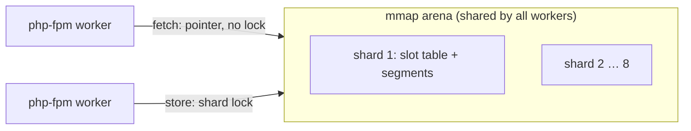

<div align="center">

# nocopy

**A shared-memory cache for PHP that hands out cached arrays without copying them.**

A drop-in replacement for APCu (`apcu_*`, `APCUIterator`, `apc.*` INI) with a lock-free read path,
segment-based eviction, and stampede-safe `nocopy_remember()`.

[](LICENSE)


</div>

```php
apcu_store('products', $rows);      // 1,000 rows
$rows = apcu_fetch('products');     // APCu: ~200 µs to rebuild the array. nocopy: ~13 ns, any size.
```

> **Status:** works and is tested in CI, not released yet. No PECL/PIE package and no Packagist entry yet: build from source.

## Why

APCu copies every value out of shared memory on each fetch: arrays are rebuilt element by element (or unserialized),
so the cost grows with the size of what you cache. Readers also take a lock, so throughput drops as workers are added.

nocopy stores arrays and strings as **opcache-style immutable structures** in one `mmap` arena that all php-fpm workers
(or ZTS threads) share. `apcu_fetch()` then returns a pointer straight into shared memory, with no copy, no unserialize and no lock.
Per-worker pins keep that memory alive until the request ends, so a fetched value can never point at freed memory.

Measured on Linux (Docker, arm64, PHP 8.5, release builds; details and method in [`HANDOVER.md`](HANDOVER.md)):

| | APCu | nocopy (copy) | nocopy (zero-copy) |
|---|---:|---:|---:|
| fetch int / 100 B string | 28.6 / 34.9 ns | 15.5 / 19.9 ns | 13.0 / 13.0 ns |
| fetch array, 1k rows | 202 µs | 91 µs | **13 ns** |
| store int / 100 B string | 55.7 / 81.8 ns | 29.3 / 34.6 ns | same as copy |
| parallel fetch int, 8 workers | 3.8 M ops/s | 154 M ops/s | **221 M ops/s** |
| Symfony app, cache-heavy page (php-fpm) | 4,116 req/s | 4,553 req/s | **14,231 req/s** |

Pages that barely touch the cache gain nothing. The gain appears where requests read large cached arrays.

**Drupal 11** (2,000 nodes, php-fpm 8 workers, MariaDB, one server; [module](drupal), [method and raw numbers](bench/results-drupal)):

| | stock (DB + APCu) | stock + igbinary | nocopy, all bins |
|---|---:|---:|---:|
| anonymous `/` (page cache) | 4,339 req/s | 4,126 req/s | **11,797 req/s** |
| logged-in node page | 506 req/s | 746 req/s | **1,027 req/s** |
| logged-in front page | 834 req/s | 596 req/s | **1,179 req/s** |
| editor: save / edit form / view after save (p50) | 34 / 55 / 47 ms | 33 / 50 / 44 ms | **26 / 37 / 24 ms** |
| readers served during editing | 468 req/s | 502 req/s | **699 req/s** |
| database queries per logged-in request | 29–31 | 29–31 | **7** |

Medians of 3 runs. The two stock configs swap places between pages (506 vs 746, 834 vs 596 req/s), so their difference is noise
in this setup: read them as one baseline. nocopy only as APCu's replacement in front of the database lands in the same range
(801–875 req/s logged-in): the gain comes from moving all bins and the cache tags off the database. Trade-offs: single server, and Drush does not share php-fpm's cache ([details](drupal#trade-offs)).

## Features

- **APCu-compatible.** `apcu_*`, `APCUIterator`, the `APC_*` constants and the `apc.*` INI names. Passes APCu's own test suite except three tests for documented non-goals ([differences](#differences-from-apcu)).
- **Zero-copy reads** under php-fpm, CGI, Apache, LiteSpeed, `php -S` and FrankenPHP classic mode. Long-running workers and the CLI get a safe **copy mode** that still reuses private copies of unchanged entries.
- **Lock-free reads, sharded writes.** Up to 8 shards with their own locks. A writer killed with `kill -9` mid-write is detected and its shard repaired.
- **Smarter eviction when full.** APCu wipes the whole cache. nocopy evicts its oldest segments and keeps entries read since they were written, using Segcache-style merging with a ghost list for keys that return.
- **Stampede protection.** `nocopy_remember()` and `apcu_entry()` run the callback once per key across all workers. `nocopy_remember()` also refreshes early via XFetch.
- **Symfony bundle** with `cache.adapter.nocopy`, which stores values without Symfony's marshaller so fetches stay zero-copy.
- **Drupal module** with a cache backend for all bins and cache tag checksums in shared memory (single server).

## Quick start

Requires PHP 8.3+ with `phpize` (e.g. the `php-dev` package), a C compiler, and Linux (CI-tested on amd64 and arm64).

```sh
git clone <this repository> nocopy && cd nocopy
phpize && ./configure && make
php -d extension=$PWD/modules/nocopy.so -d apc.enable_cli=1 \
    -r 'apcu_store("a", [1, 2, 3]); var_dump(apcu_fetch("a"));'
```

To enable it for your server, load it in `php.ini` (or a `conf.d` file) **instead of** APCu:

```ini
extension=/path/to/nocopy/modules/nocopy.so
nocopy.shm_size=128M
```

Existing `apcu_*` code and `apc.shm_size` / `apc.ttl` / `apc.entries_hint` settings keep working.

## Usage

### Native API

```php
nocopy_put('config', $config, ttl: 300);         // throws on objects unless $serialize: true
$config = nocopy_get('config', $hit);            // $hit tells a miss from a stored null/false
nocopy_delete('config');

// Compute once across all workers, refresh shortly before expiry
$report = nocopy_remember('report', fn (string $key) => buildReport(), ttl: 60);

print_r(nocopy_stats());                         // hits, misses, evicted, expired, expunges, used, …
```

`nocopy_remember($key, $callback, $ttl = 0, $beta = 1.0)`: on a miss, the first worker takes a lease and runs the callback.
The others wait for its value. A dead lease holder is detected, a stuck one is ignored after 30 s, and a recursive call on the same key does not wait.
Before the TTL ends, one worker refreshes early ([XFetch](https://doi.org/10.14778/2757807.2757813), Vattani et al., VLDB 2015) with a probability that rises
as expiry nears, scaled by the callback's measured run time × `$beta`. The others keep getting the current value. `$beta = 0` turns this off.

### Symfony

Symfony's built-in `cache.adapter.apcu` serializes values before they reach the extension, which removes the zero-copy benefit.
The bundle in [`symfony/`](symfony) (`chrfritsch/nocopy-bundle`, Symfony 6.4 / 7.x / 8.x) adds a pool that stores values unserialized.
Until it is on Packagist, install it from a checkout:

```sh
composer config repositories.nocopy path /path/to/nocopy/symfony
composer require chrfritsch/nocopy-bundle:@dev
```

Register `Chrfritsch\NocopyBundle\NocopyBundle` in `config/bundles.php`, then:

```yaml
# config/packages/cache.yaml
framework:
    cache:
        app: cache.adapter.nocopy
```

The adapter uses `nocopy_*` only, so it also works with `nocopy.apcu_compat=0` and next to real APCu.
`clear()` bumps a namespace version instead of deleting keys, and old entries leave through normal eviction.

### Drupal

The module in [`drupal/`](drupal) (`chrfritsch/nocopy-drupal`, Drupal 11.2+) puts every cache bin and the cache tag checksums
in nocopy, so cache reads and tag checks no longer touch the database. Install it, enable it, and add the `settings.php` lines from
[`drupal/README.md`](drupal/README.md). It is for single-server sites.

> **Drush and cron do not reach php-fpm's cache.** CLI processes get their own memory, so cache clears and tag invalidations from
> `drush cr`, `drush cim`, `drush updb` or `drush cron` (scheduled publishing, queues, migrations) never reach the web workers, and they keep
> serving stale pages. Reload php-fpm after every CLI run that changes content or config, or run cron through the web (`/cron/<key>`).

Reproduce the benchmark:

```sh
docker build --build-arg PHP=8.5 -t nocopy-linux:8.5 docker && docker build -t nocopy-drupal -f docker/Dockerfile.drupal docker
docker run --rm -v "$PWD":/src:ro -v nocopy-drupal-bench:/site -v "$PWD/bench/results-drupal":/out nocopy-drupal /src/docker/drupal-bench.sh
```

## Configuration

All settings are `PHP_INI_SYSTEM` (php.ini only).

| Setting | Default | Meaning |
|---|---|---|
| `nocopy.shm_size` | `32M` | Arena size. Alias: `apc.shm_size` |
| `nocopy.ttl` | `0` | Default TTL in seconds (0 = none). Alias: `apc.ttl` |
| `nocopy.entries_hint` | `4096` | Sizes the fixed slot table (~2 slots per hinted entry, at least one per 256 B of arena). Raise it for many entries under ~300 B, or the cache evicts before its memory is full. Alias: `apc.entries_hint` |
| `nocopy.request_scope` | `auto` | `auto`: zero-copy under fpm, CGI, Apache, LiteSpeed, `php -S` and FrankenPHP classic mode, copy mode elsewhere. `1`: zero-copy also under the CLI (pins every segment read until the script ends). `0`: always copy |
| `nocopy.local_size` | `8M` | Copy mode only: keeps private copies of arrays and strings (≥ 512 B) fetched twice and hands them out again while the entry is unchanged. Counts against `memory_limit`. `0` = off |
| `nocopy.serializer` | `php` | `php` or `igbinary`: the format for values stored serialized (objects, shared references). Arrays and scalars are never serialized. `igbinary` needs the igbinary extension, otherwise a startup warning and `php`. Alias: `apc.serializer` |
| `nocopy.apcu_compat` | `1` | Registers `apcu_*`, `APCUIterator`, `APC_*` and `apc.*`. `0`: only `nocopy_*`, so real APCu can be loaded too. If APCu is already loaded, nocopy switches to `0` itself and logs a startup warning |
| `apc.enabled`, `apc.enable_cli` | `1`, `0` | As in APCu. These switch the `apcu_*` functions, not `nocopy_*` |

If both an `apc.*` alias and its `nocopy.*` name are set, the `nocopy.*` value wins and a startup warning is logged.
FrankenPHP worker scripts switch to copy mode at their first `frankenphp_handle_request()`, whatever `request_scope` says.

## How it works



- **Arena:** one `mmap(MAP_SHARED|MAP_ANONYMOUS)` created at startup, so every forked worker sees it at the same address.
- **Segments:** writes append to 64 KB–2 MB segments, bucketed by TTL. Expired entries are swept a few at a time on each write.
- **Pins:** each worker marks the segments it holds values from. A segment is reused only when no worker pins it, so zero-copy values stay valid until the request ends.
- **Merge:** when a shard is full, sparse segments are compacted. Failing that, the oldest are merged: recently read entries move forward and the rest are evicted, a few hundred at a time.

The full design, including invariants and failure handling, is in [`ARCHITECTURE.md`](ARCHITECTURE.md).

## Differences from APCu

The API behaves the same. What depends on APCu's internal layout differs by design:

| | APCu | nocopy |
|---|---|---|
| Cache full | wipes everything | evicts oldest segments, keeps recently read entries |
| `apcu_entry()` | callback runs under the global cache lock | single-flight per key, other keys stay writable |
| `apcu_sma_info()` | one segment | one "segment" per shard (an entry fits only in its own shard) |
| Per-entry `num_hits`, `access_time`, `ref_count` | counted | `0`, creation time, `0` (no shared write per read) |
| `APCUIterator`, `cache_list` | under the cache lock | lock-free: under concurrent writes an entry may be skipped or seen twice |
| `apc.serializer` | used for every value | used only for objects and shared references; arrays/scalars are stored natively |
| `apc.preload_path`, `apc.slam_defense`, `apc.gc_ttl`, `apc.mmap_file_mask` | supported | ignored |

Other limits: the arena is split into up to 8 shards of at least 8 MB each, and a single entry must fit into one shard.
Under ZTS, nocopy is tested with `parallel` and FrankenPHP, not with mod_php under a threaded MPM.

## Development

```sh
phpize && ./configure && make
make test TESTS=tests                                            # .phpt suite (a debug PHP build catches more)
PHP=php NOCOPY_SO=$PWD/modules/nocopy.so scripts/apcu-suite.sh   # APCu's own suite against nocopy
tests/c/run.sh                                                   # arena alone, 8 threads, plain + ThreadSanitizer
```

The Linux toolchain used by CI lives in [`docker/`](docker):

```sh
docker build --build-arg PHP=8.5 -t nocopy-linux docker
docker run --rm -v "$PWD":/src:ro nocopy-linux /src/docker/test.sh      # build + test suite
docker run --rm -v "$PWD":/src:ro nocopy-linux /src/docker/stress.sh 30 # race stress loop
```

Benchmarks against APCu need release builds of PHP and both extensions: `PHP=… NOCOPY_SO=… APCU_SO=… bench/all.sh`.
CI ([`.github/workflows/ci.yml`](.github/workflows/ci.yml)) covers PHP 8.3/8.4/8.5 on amd64 and arm64, ZTS 8.4, FrankenPHP and Symfony 6.4/7.4/8.x.

For project state, measurement history and next steps, see [`HANDOVER.md`](HANDOVER.md).

## Contributing

Bug reports and pull requests are welcome. Please include the PHP version, SAPI (fpm, FrankenPHP, CLI…), NTS/ZTS and the output of `nocopy_stats()`.
Changes to locking or eviction should pass the stress loops (`docker/stress.sh`, `tests/c/run.sh`). See the invariants in [`ARCHITECTURE.md`](ARCHITECTURE.md).

## License

[MIT](LICENSE) © 2026 Christian Fritsch.
Eviction design inspired by [Segcache](https://www.usenix.org/conference/nsdi21/presentation/yang-juncheng) (Yang et al., NSDI 2021); API compatible with [APCu](https://github.com/krakjoe/apcu).
