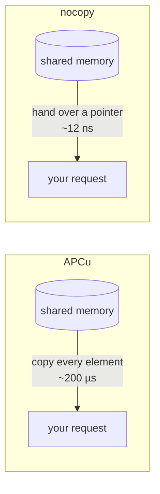
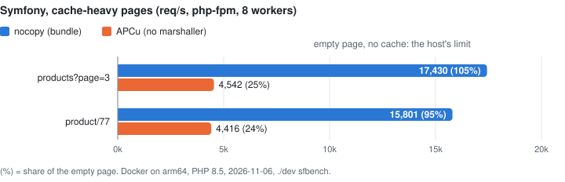

<div align="center">

# nocopy

**A cache for PHP that reads a 1,000-row array as fast as a single integer.**

Simple `put` / `get` functions, one cache shared by every PHP worker on the machine, and no copying on read.

[](LICENSE)


</div>

```php
nocopy_put('products', $rows);      // 1,000 rows
$rows = nocopy_get('products');     // APCu: ~200 µs. nocopy: ~12 ns. Any size.
```

> **Status:** works and is tested, not released yet: build from source ([status and roadmap](docs/status.md)).

## The idea in one picture

APCu and similar caches keep your data in memory that all PHP workers share. But every time you read a value, they
**copy it** into your request, element by element. A big array means a big copy, on every single read.

nocopy hands your code the shared value **itself**. Nothing is copied, so reading a huge array costs the same as reading
a number.



Think of a library: APCu photocopies the whole book each time you want to read it. nocopy lets you read it right on the
shelf. And if you write in it? PHP quietly makes you a private copy first, exactly as it does with any array you pass
around. Your code never notices.

## How much faster?

| | without nocopy | with nocopy |
|---|---:|---:|
| Read an array with 1,000 rows (vs APCu) | 200 µs | **12 ns** |
| Read an int / a 100-byte string (vs APCu) | 28.2 / 34.4 ns | 11.0 / 11.5 ns |
| Reads per second (int), 8 workers in parallel (vs APCu) | 3.7 M | **350 M** |
| Write an int / an array with 1,000 rows (vs APCu) | 55.3 ns / 191 µs | 27.3 ns / 59 µs |
| Writes per second (int), 8 workers in parallel (vs APCu) | 10.4 M | **141 M** |
| Symfony app, cache-heavy page (vs APCu) | 4,542 req/s (25% of an empty page) | **17,430 req/s (~100%)** |
| Drupal 11, one server (vs stock): anonymous / logged-in node page | 4,671 / 835 req/s | **12,145 / 1,122 req/s** |
| Drupal 11, several servers (vs drupal/redis): anonymous / logged-in node page | 4,837 / 634 req/s | **12,538 / 1,152 req/s** |
| Drupal 11, JSON:API list of 20 articles, logged in (vs stock) | 1,200 req/s | **2,084 req/s** |
| Drupal 11, database queries per logged-in request (vs stock) | 18–31 | **7** |

<picture>
  <source media="(prefers-color-scheme: dark)" srcset="docs/reference/symfony-ceiling-dark.svg">
  
</picture>

Linux, Docker on arm64 (Apple M3 Pro), PHP 8.5; the read ratios hold on AWS Graviton4 (writes not cross-checked yet). How to reproduce: [benchmark results](docs/reference/benchmarks.md).

**The fine print:** the no-copy trick pays off when your requests read big cached arrays (config, routes, translations,
entity lists). If your pages barely touch the cache, you won't see a difference. Objects are rebuilt from their
stored properties without unserializing (except `Serializable` and most internal classes: serialized, as in APCu).

On Drupal, most of the gain comes from something else: because php-fpm, Drush and cron share one cache that survives
restarts, every cache bin and cache tag can move out of the database. Not copying adds little there
([breakdown](docs/reference/benchmarks.md#drupal-11-where-the-gain-comes-from-dev-drupal-bench)).

## What you get

| | |
|---|---|
| ⚡ **Fast reads** | No copy, no unserialize, no lock while reading. |
| 🖥️ **One cache for web and CLI** | php-fpm, Drush, `bin/console` and cron jobs all see the same cache, and it survives php-fpm restarts. |
| 🧹 **Graceful when full** | APCu throws away the *whole* cache when memory runs out. nocopy removes the oldest, least-read entries and keeps the popular ones. |
| 🚦 **No stampedes** | `nocopy_remember()` computes an expensive value **once**, even if 100 workers ask for it at the same moment, and refreshes it shortly before it expires. |
| 🌐 **Several servers** | Point it at [Valkey](https://valkey.io) (the open-source Redis fork) and all servers share one cache, while each keeps a fast local copy that stays in sync automatically. No extra PHP extension needed. |
| 🛡️ **Crash-safe** | A worker killed mid-write (OOM killer, `kill -9`) can't corrupt the cache: the damage is detected and repaired. |
| 🧩 **Framework integrations** | [Symfony bundle](docs/how-to/symfony.md) (`cache.adapter.nocopy`), [Drupal module](drupal/README.md) (all cache bins and cache tags). |
| 🔁 **Easy switch from APCu** | A [polyfill](apcu) provides the `apcu_*` functions on top of nocopy, for code you can't change yet ([differences](docs/reference/apcu-compatibility.md)). |
| 🔍 **Console** | [`nocopy-cli`](cli) shows stats and keys, reads, deletes and clears entries in the running cache, like cachetool. |

Works with php-fpm, Apache, LiteSpeed, CGI, `php -S` and FrankenPHP. Long-running processes (CLI scripts, queue workers,
FrankenPHP worker mode) automatically get a safe mode that hands out private copies and reuses them while the entry is
unchanged.

## Try it in one minute

All you need is Docker:

```sh
git clone <this repository> nocopy && cd nocopy
./dev shell
php -r 'nocopy_put("a", [1, 2, 3]); var_dump(nocopy_get("a"));'
```

## Use it

The whole API fits on a sticky note:

```php
nocopy_put('products', $rows, ttl: 300);    // store for 5 minutes
$rows = nocopy_get('products', $hit);       // $hit is true if it was found

$report = nocopy_remember('report', fn () => buildReport(), ttl: 60);   // compute once, cache, return

nocopy_inc('page_views');                   // atomic counter
nocopy_delete('products');
```

Also: `nocopy_add`, `nocopy_cas`, `nocopy_get_multiple`, `nocopy_put_multiple`, `nocopy_delete_multiple`,
`nocopy_clear`, `nocopy_keys`, `nocopy_stats`, `nocopy_shared_with`. All of them: [function reference](docs/reference/functions.md).

## Install on a server

You need Linux, PHP 8.4+ with its dev tools (`phpize`) and a C compiler. No C knowledge required:

```sh
pie repository:add vcs https://github.com/chrfritsch/nocopy   # until it is on Packagist
pie install chrfritsch/nocopy     # or from source: phpize && ./configure && make
```

Then configure it in a file read by both php-fpm and the CLI (e.g. `conf.d/nocopy.ini`):

```ini
extension=nocopy            ; PIE adds this line itself
nocopy.shm_name=/nocopy     ; required: the cache's name, so web and CLI share it
nocopy.shm_size=128M        ; how much memory the cache may use
```

Step by step: [install guide](docs/how-to/install.md). Several servers: [Valkey guide](docs/how-to/valkey.md).

## Learn more

| New here | Using it | How it works |
|---|---|---|
| [Your first cache](docs/tutorials/first-cache.md) (10-minute tutorial) | [Symfony](docs/how-to/symfony.md) · [Drupal](drupal/README.md) · [Migrate from APCu](docs/how-to/migrate-from-apcu.md) | [How nocopy works](docs/explanation/how-it-works.md) |
| [Install on a server](docs/how-to/install.md) | [Share between php-fpm and CLI](docs/how-to/share-between-fpm-and-cli.md) · [Valkey](docs/how-to/valkey.md) | [Design decisions](docs/explanation/design-decisions.md) (with numbers) |
| | [Size and monitor](docs/how-to/size-and-monitor.md) · [Configuration](docs/reference/configuration.md) · [`nocopy_stats()`](docs/reference/stats.md) | [Architecture](docs/explanation/architecture.md) (internals) |

Everything: [docs/](docs/README.md).

## Contributing

Bug reports and pull requests are welcome. For a bug, please include your PHP version, how PHP runs (php-fpm,
FrankenPHP, CLI…), whether it's thread-safe (`php -v` shows `ZTS` or `NTS`), and the output of `nocopy_stats()`.

You don't need PHP or a compiler on your machine, just Docker: `./dev test` builds and runs the tests, `./dev ci` runs
what CI runs. Start with the [first change tutorial](docs/tutorials/first-change.md), then
[Develop, test and benchmark](docs/how-to/develop.md).

## License

[MIT](LICENSE) © 2026 Christian Fritsch.
Eviction design inspired by [Segcache](https://www.usenix.org/conference/nsdi21/presentation/yang-juncheng) (Yang et al., NSDI 2021); the polyfill follows [APCu](https://github.com/krakjoe/apcu)'s API.
