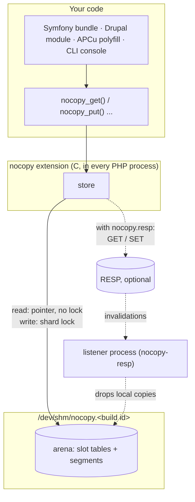

# Architecture

This page shows the parts nocopy is made of and what happens on a read or a write. It is for PHP developers who want to
know what they are running. For the ideas behind it, read [How nocopy works](how-it-works.md) first; terms are in the
[glossary](../reference/glossary.md).

## The parts



| Part | What it is | Where |
|---|---|---|
| Extension | The C code PHP loads: the `nocopy_*` functions, the INI settings | `nocopy.so` |
| Arena | The cache itself: one block of shared memory that every PHP process on the server maps | `/dev/shm/<shm_name>.<build id>` |
| RESP tier | Optional: makes RESP the shared cache of several servers; the arena then holds local copies | inside `nocopy.so` (left out with `--disable-nocopy-resp`) |
| Listener | With RESP only: one background process per server that hears about changes and drops outdated copies | `nocopy-resp` in `ps` |
| APCu polyfill | `apcu_*` functions written in PHP on top of `nocopy_*` | [`apcu/`](../../apcu) |
| Symfony bundle | `cache.adapter.nocopy` | [`symfony/`](../../symfony) |
| Drupal module | Cache backend, cache tags, locks, flood control | [`drupal/`](../../drupal) |
| CLI console | `stats`, `keys`, `get`, `delete`, `clear` from a shell | [`cli/`](../../cli) |

## What is in the shared memory

```
┌────────────┬─────────────┬────────────────────┬───────────┬───────────┬─────┐
│ header     │ slot tables │ shared strings and │ segment 0 │ segment 1 │ ... │
│ (counters, │ (find keys) │ arrays (shm/16)    │           │           │     │
│  workers)  │             │                    │           │           │     │
└────────────┴─────────────┴────────────────────┴───────────┴───────────┴─────┘
```

- The **header** holds counters, locks and one slot per PHP process or thread that uses the cache.
- The **slot tables** map a key's hash to the place where its entry lives. Their size is fixed when the cache is created
  (`nocopy.entries_hint`).
- **Shared strings and arrays** that many entries contain are stored once here.
- **Segments** (64 KB to 4 MB each) hold the entries, written one after the other. Each entry is a small header plus your
  value, laid out the way PHP lays out its own immutable arrays and strings, so PHP can use it in place.

The cache is split into up to 8 **shards**. A key's hash picks its shard; each shard has its own lock and its own part of
the slot table, and takes segments from a shared pool as it needs them.

## A read, step by step

`$rows = nocopy_get('products');` in a php-fpm request:

1. Hash the key and look it up in its shard's slot table. **No lock.**
2. Mark the entry's segment as in use by this process (a "pin"), then check the slot still points at the same entry.
3. Return the value in place: a pointer into shared memory, no copy. If your code changes the array, PHP copies it first.
4. When the request ends, the pins are released and the segment can be reused.

In a CLI script or a FrankenPHP worker, step 3 makes a private copy instead, and keeps it for reuse if the same value is
read again while it is unchanged.

## A write, step by step

`nocopy_put('products', $rows, ttl: 300);`

1. Walk the value once to work out its exact size and what can be shared (repeated strings, arrays already stored).
   Objects' `__serialize()` / `__sleep()` run here, before any lock is taken.
2. Take the shard's lock, reserve space at the end of the open segment for this TTL, and copy the value in. (Values over
   2 KB are copied with the lock released, so other writers to the shard don't wait for them.)
3. Point the key's slot at the new entry and mark the old one dead. Release the lock.

Readers never wait for writers: a reader that already holds the old value keeps it, the next one gets the new value.

## When memory runs out

Expired entries are removed a few at a time on every write. When there is no free segment, nocopy first compacts
segments that are mostly dead (nothing is lost), then merges the oldest segments: entries that were read move forward,
the rest are evicted. More in [How nocopy works](how-it-works.md#when-the-cache-is-full).

## When a process crashes

A PHP worker can be killed at any moment (OOM killer, `kill -9`, `request_terminate_timeout`). Each process holds a
kernel file lock on its slot in the shared memory, and the kernel releases it when the process dies. So:

- A lock held by a dead process is taken over by the next writer, which repairs that shard from its slot table
  (`lock_steals` in `nocopy_stats()`).
- Pins of a dead process are ignored, so its segments can be reused.
- A half-written entry is never visible: a key points at an entry only once it is complete.

## With RESP

With `nocopy.resp` set, the arena becomes a local copy of what RESP holds:

- **Read:** a local hit works as above. A local miss fetches from the RESP server and stores a local copy.
- **Write:** stored locally, then sent to the RESP server.
- **Change elsewhere:** the RESP server notifies each web server's listener, which drops the local copy.
- **Server unreachable:** nothing local is served (it could be outdated); reads miss and writes fail until it is back.

Details: [Sharing](sharing.md#several-servers-resp-as-the-cache-of-record).

## Limits

| Limit | Value |
|---|---|
| Cache size (`nocopy.shm_size`) | up to 32G |
| Largest entry | a bit less than `shm_size / shards` ([table](../how-to/size-and-monitor.md#the-largest-entry-you-can-store)) |
| Shards | 1-8, depending on size |
| Processes and threads sharing one cache | 1024 |
| Cache name (`nocopy.shm_name`) | one leading slash, at most 40 characters |
| Nesting depth stored without serializing | 64 levels (deeper values are serialized) |
| `nocopy_remember()` computations at once | 32 per shard (beyond that, a caller computes without waiting) |
| Platforms | Linux on amd64 and arm64; PHP 8.4 and 8.5, NTS and ZTS |

## Going deeper

- [Design decisions](design-decisions.md): why it is built this way, with numbers.
- For contributors changing the C code: [the internals](../internals/architecture.md) (code layers, memory layout,
  locking, invariants) and the [design log](../internals/design-decisions.md) (every measurement and rejected idea).
