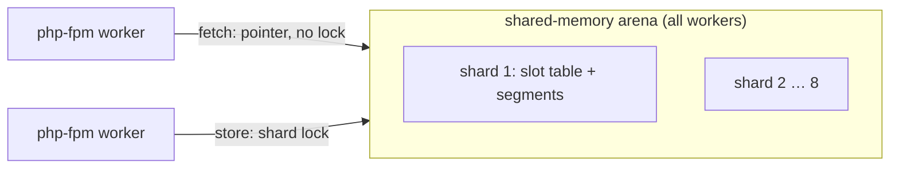

# How nocopy works

## The problem with APCu

APCu keeps values in shared memory, but every fetch copies the value out into the process: arrays are rebuilt element by
element (or unserialized). The cost grows with the size of what you cache, so a 1,000-row array costs about 200 µs per
fetch, every time. Readers also take a lock, so throughput drops as workers are added.

## The idea: hand out the shared memory itself

PHP's opcache already shares arrays between processes without copying: it stores them as **immutable** structures that
PHP knows not to modify or free. nocopy stores cached arrays and strings the same way, in one shared-memory arena that all
php-fpm workers (or ZTS threads) map at the same address. `nocopy_get()` then returns a pointer straight into shared memory:
no copy, no unserialize, no lock. A 1,000-row array costs 12 ns, about the same as an integer.

If you change a fetched array, PHP copies it first (copy-on-write), as with any immutable array. Your code does not notice.

## Keeping pointers valid: pins

A pointer into shared memory is only safe while that memory is not reused. Each worker marks the **segments** it holds
values from in its own bitmap (a pin). A segment is reused only when no worker pins it, and pins are released when the
request ends. So a value you fetched stays valid for the whole request, even if another worker deletes or overwrites the key.

## Zero-copy and copy mode

Pins last until the request ends, which is fine for web requests but not for processes that never end a request: a CLI
script, a queue worker, a FrankenPHP worker script. They could pin memory forever. So nocopy picks the fetch mode from
the SAPI (not configurable):

- **Zero-copy** (default under php-fpm, CGI, Apache, LiteSpeed, `php -S`, FrankenPHP classic): the pointer, pinned until the request ends.
- **Copy** (default for the CLI and FrankenPHP workers): a private copy, made with one `memcpy` for the array structure.
  Copies of values fetched twice are kept per process (`nocopy.local_size`) and handed out again while the entry is
  unchanged, so repeated fetches in a worker are nearly as cheap as zero-copy.

Objects and shared references cannot be immutable: they are stored as nodes and rebuilt on each fetch (with the arrays that
hold them), while the strings and arrays inside them stay shared. Objects that can't be nodes (`__sleep`, `Serializable`, ...)
make the whole value serialized and unserialized on every fetch.

## Writes, shards and segments

Writes append to **segments** (64 KB-2 MB), grouped by TTL so entries that expire together sit together. A key's hash
picks one of up to 8 **shards**, each with its own lock and slot table, taking segments from a shared pool: writers to
different shards never wait for each other, readers never lock, and a busy shard can use what the others leave free
(and gives it back when they need it). If a writer dies mid-write (kill -9, OOM killer), the next writer
detects it and repairs that shard.

## When the cache is full

APCu wipes everything when it runs out of memory. nocopy evicts gradually, in the style of
[Segcache](https://www.usenix.org/conference/nsdi21/presentation/yang-juncheng):

1. Expired entries are swept a few at a time on every write.
2. Segments with enough dead space (overwritten or deleted entries) are compacted: their live entries move forward, nothing is lost.
3. Otherwise the oldest segments are merged: entries read since they were written move forward, the rest are evicted.
   A small read counter per entry decides who stays; a "ghost" list remembers recently evicted keys and protects them
   when they come back.

## Stampedes

When a popular entry expires, every worker misses at once and recomputes it. `nocopy_remember()` lets only the first
worker compute (a lease per key) while the others wait for its result, and refreshes slightly before expiry
(probabilistic early expiration, XFetch), so most expiries never cause a miss at all. When one does, the waiters get the
just-expired value while the first worker recomputes.

## One cache per machine, or per cluster

The arena is a named shared-memory object (`nocopy.shm_name`), so php-fpm, the CLI and restarted servers all attach to the
same cache. With `nocopy.valkey`, Valkey becomes the shared cache of several servers and each local arena holds copies
in front of it. Why it is designed this way: [Sharing](sharing.md).

Going deeper: [Design decisions](design-decisions.md) (with numbers), [Architecture](architecture.md) (internals and invariants).
