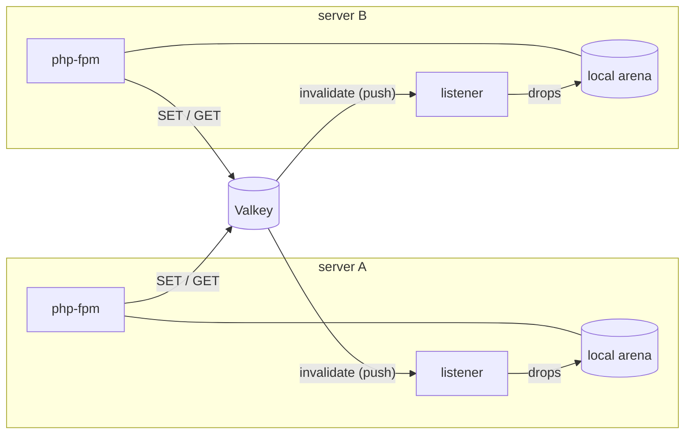

# Sharing: by name and through Valkey

A cache is only correct if everyone who writes to it and everyone who reads from it see the same thing. This page explains
how nocopy makes sure of that, and why some of its rules look strict.

## Why the name is required

The cache lives in a named POSIX shared-memory object: with `nocopy.shm_name=/nocopy`, the first process creates
`/dev/shm/nocopy.<build id>` and every later one attaches to it at the same address. So php-fpm, Drush/cron/console
commands and a restarted server share one cache, in both directions.

There is deliberately **no default name**: two sites of one user would silently share keys.

## All or nothing

A process without `nocopy.shm_name`, or one that cannot attach (another user's object, `/dev/shm` full), has **no cache**:
fetches miss and writes return `false`, with a startup warning. It never falls back to a private cache.

A private cache would look like it works, but its writes and deletes would not reach anyone else. Picture `drush cr` clearing
a private cache while php-fpm keeps serving the old data, or a cron job invalidating cache tags nobody else sees. A cache that
is off is slow; a cache that is split is wrong. `nocopy_shared_with()` lets code check (`host`, `valkey`, `none`), and the
Drupal module throws on `none` rather than serve stale data.

## One user, one build, one machine

- **One user.** The object is created with mode `0600`. Anyone who can write it controls what php-fpm reads (it hands out
  pointers into it), so the mode is not configurable.
- **One build.** The build id hashes the loaded `nocopy.so`: different code may lay out memory differently, so processes
  share only when they run the same build. Objects of old builds are removed once no process uses them.
- **One machine (one PID namespace).** A lock held by a crashed process is detected by its pid and start time, which only
  works where pids mean the same thing. Separate containers do not share.

The creator reserves the whole `nocopy.shm_size` up front (`posix_fallocate`), so memory can never run out under a reader.
On tmpfs, a lazily-allocated page past `/dev/shm`'s limit would crash the process on first touch instead.

## Several servers: Valkey as the cache of record

Shared memory ends at the machine. With `nocopy.valkey`, Valkey holds the data every server shares, and each server's arena
holds local copies:

- **Writes** go to the local arena and to Valkey (`SET`). Deletes, `add`, `inc`, `cas` and `clear` run in Valkey.
- **Reads** are served locally when there is a copy (zero-copy, no round trip); a local miss is fetched from Valkey and kept.
- **Invalidation:** Valkey's client-side tracking pushes every change under the prefix (writes, deletes, expiry, eviction)
  to a listener process on each server, which drops the local copy.

### One listener per server, not per worker

Tracking pushes go to whichever connection asked for them. If every worker tracked, 16 workers meant 16 connections and 16
copies of every push per server. Instead one process per arena (`nocopy-valkey` in `ps`) holds the only tracking connection
and drops copies for everyone. It is started by the first process that needs it, restarted by the next one if it dies (no
heartbeat for 1 s), and outlives php-fpm restarts, so the local cache stays warm and in sync.

### Never serve what might be stale

The listener pings Valkey every second. While its connection is down or silent, nothing local is served: invalidations
might be missing. On every (re)connect it clears the local arena, because it cannot know what it missed. When Valkey is
unreachable, fetches miss and writes fail: misses are slow, stale data is wrong.

A fill guard closes the last gap: a worker that fetched a value from Valkey checks an invalidation counter before storing it
locally, and drops its copy if an invalidation arrived in between.

### Costs

- The writer's own server also gets its write pushed back and refetches it once: fine for cache traffic, wasteful for
  counters bumped on every request.
- `nocopy_stats()` and the single flight of `nocopy_remember()` are per server.
- Valkey evicts by its own policy; an evicted key is a miss on every server.

Setup: [Share one cache between php-fpm and the CLI](../how-to/share-between-fpm-and-cli.md), [Valkey](../how-to/valkey.md).
Internals: [Architecture: Valkey tier](architecture.md#valkey-tier-nocopy_valkeyc).
