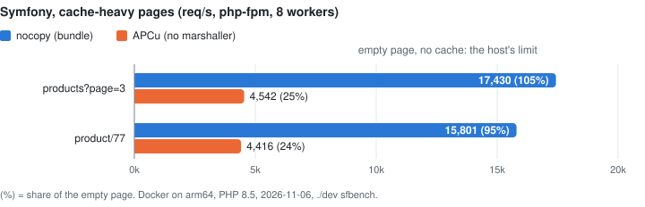

# Benchmark results

Linux in Docker on arm64, PHP 8.5, release builds. Reproduce with `./dev bench`, `./dev sfbench` and `./dev drupal-bench`
([how](../how-to/develop.md#benchmark)). Numbers on a dedicated x86_64 box are still to come ([status](../status.md)).

## Micro benchmarks (`./dev bench`)

| | APCu | nocopy (copy) | nocopy (zero-copy) |
|---|---:|---:|---:|
| fetch int / 100 B string | 28.2 / 34.4 ns | 11.6 / 19.5 ns | 11.0 / 11.5 ns |
| fetch array, 1k rows | 200 µs | 13 ns (kept copy) | **12 ns** |
| store int / 100 B string | 56.5 / 81.3 ns | 27.2 / 28.9 ns | same as copy |
| parallel fetch int, 8 workers | 3.7 M ops/s | 266 M ops/s | **350 M ops/s** |

2026-11-06. Copy mode reuses a kept private copy of an unchanged entry (`nocopy.local_size`): that is what the bench's
repeated fetch measures; the first fetch of 1k rows costs ~68 µs.

**Cross-check on Graviton4** (AWS c8g.xlarge, Kubernetes pod capped at 3 vCPU, PHP 8.5.12, same `docker/bench.sh`, 2026-11-05):
absolute times are higher for both, the ratios hold.

| | APCu | nocopy (zero-copy) | ratio here / above |
|---|---:|---:|---:|
| fetch int | 95.1 ns | 22.6 ns | 4.2x / 2.2x |
| fetch array, 1k rows | 264 µs | 22.9 ns | ~11,500x / ~15,500x |
| fetch array, 10k rows | 2.96 ms | 22.9 ns | size still irrelevant |
| parallel fetch int, 8 workers | 3.6 M ops/s | 104 M ops/s | 29x / 58x (3 vCPU cap) |
| 4 readers + 1 writer, reader throughput | 8.1 k ops/s | 1.63 M ops/s | |

## Symfony (`./dev sfbench`)

`bench/sfapp` behind nginx + php-fpm, 8 static workers, `ab`, median of 3 (2026-11-06). PHP set up as Symfony's
[performance guide](https://symfony.com/doc/current/performance.html) recommends: OPcache sized up, timestamps off, realpath
cache, preload, `--classmap-authoritative`, `.container.dumper.inline_factories`. One run, evening of 2026-11-06, with objects
stored as graph nodes (the morning's run before them: nocopy 15,295 / 16,285 / 17,467 / 8,964, APCu within 5% of today).

| req/s | APCu (Symfony's marshaller) | APCu (no marshaller) | nocopy (bundle) |
|---|---:|---:|---:|
| cache-heavy page (`products?page=3`) | 3,167 | 4,542 | **17,430** |
| cache-heavy page (`product/77`) | 3,205 | 4,416 | **15,801** |
| no cache (`hello`) | 14,521 | 18,182 | 16,660 |
| validator (`validate`)¹ | 9,100 | 9,347 | 9,047 |
| `products` as a share of `hello` | 22% | 25% | **~100%** |
| `product/77` as a share of `hello` | 22% | 24% | **95%** |

<picture>
  <source media="(prefers-color-scheme: dark)" srcset="symfony-ceiling-dark.svg">
  
</picture>

Chart from `bench/sfchart.py` (numbers inside it). `hello` returns `ok` with no cache: it is what the host serves with the cache costing nothing. nocopy's cache-heavy pages
reach 95-100% of it (`products` above nocopy's own `hello` is run-to-run noise, ~5%), so a faster nocopy has nothing left to add: the ratio to APCu is capped by the host, not by nocopy.
¹ A later run, with the bundle putting nocopy in front of Symfony's system pools. Before, those pools ran on PHP files alone
(Symfony chains APCu in front only when APCu is loaded) and `validate` was 12-20% below APCu: 9,286 / 10,252 / 8,182. Pages that barely touch the cache gain nothing. Before the production settings (2026-11-05): 3,815 (APCu) vs 8,924 req/s
(nocopy) on `products`, with a `hello` ceiling of ~9,400.

## Drupal 11: where the gain comes from (`./dev drupal-bench`)

2,000 nodes, php-fpm 8 workers, MariaDB, Valkey on the same host; median of 3 runs on the evening of 2026-11-06
([raw numbers](../../bench/results-drupal/2026-11-06-prod)). Production PHP as for Symfony (OPcache sized up, timestamps off,
realpath cache) and `composer dump-autoload --optimize` (not `--classmap-authoritative`: Drupal adds module namespaces at
runtime). igbinary in every config except stock, nocopy configs load the `apcu_*` polyfill as the Drupal module does.
Pages: the front page, a node, a term and a JSON:API list of 20 articles (`/jsonapi/node/article?page[limit]=20`). Each row
changes one thing against the one above it:

| | anonymous `/` | logged-in `/` / node / JSON:API | DB statements anon / logged-in | first request after fpm restart | Drush save visible on the web |
|---|---:|---:|---:|---:|:---:|
| stock: DB bins, APCu fast layer | 4,671 req/s | 797 / 835 / 1,200 req/s | 7 / 18-31 | 225 ms | yes |
| apcu-all: all bins in APCu, tags in DB | 5,883 req/s | 1,098 / 1,038 / 1,382 req/s | 5 / 10-13 | 629 ms | **no** |
| nocopy-all-dbtags: all bins in nocopy, tags in DB | 8,009 req/s | 1,269 / **1,141** / 1,777 req/s | 5 / 10-13 | 203 ms | yes |
| nocopy-all: bins and tags in nocopy | **12,145 req/s** | **1,365** / 1,122 / **2,084 req/s** | **0 / 7** | 201 ms | yes |

- **Bins out of the database** (stock → apcu-all): +26% anonymous, +38% / +24% / +15% logged-in. Any memory cache gets this.
- **No copy on read** (apcu-all → nocopy-all-dbtags): +36% anonymous, +16% / +10% / +29% logged-in. JSON:API gains most:
  its cached normalizations are objects (`CacheableNormalization`), rebuilt from their stored properties instead of unserialized.
- **Tags out of the database** (nocopy-all-dbtags → nocopy-all): +52% anonymous (the page cache hit needs no query at
  all); logged-in +8% / -2% / +17%.
- apcu-all is only a measuring point: Drush and cron write to their own APCu, so their saves never reach php-fpm, and
  the cache starts empty after every fpm restart. What nocopy adds over it is one cache for every process that survives
  restarts, which is what makes moving all bins off the database safe.

Against the morning's runs ([raw](../../bench/results-drupal/2026-11-06): no production PHP, objects still serialized),
stock gained most from the production settings (anonymous 3,814 -> 4,671 req/s, logged-in node 702 -> 835), so nocopy-all's lead
over it shrank from 2.9x / 1.5x to 2.6x / 1.3x (anonymous `/` / logged-in node).

Editor loop under reader load (p50; save / edit form / view after save) and readers served meanwhile:

| | stock | apcu-all | nocopy-all-dbtags | nocopy-all |
|---|---:|---:|---:|---:|
| editor | 31 / 48 / 42 ms | 31 / 34 / 21 ms | 28 / 33 / 20 ms | **21 / 32 / 19 ms** |
| readers | 508 req/s | 631 req/s | 742 req/s | **770 req/s** |

Without the `apcu_*` polyfill Drupal's class loader and FileCache find no `apcu_fetch()` and Composer checks the file system
for every class (strace: 807 `faccessat` per logged-in request, 65 with the polyfill, 68 with APCu). nocopy-all without and with
it, median of 3 interleaved runs in the morning's setup (req/s): logged-in `/` 986 -> 1,290, node 1,042 -> 1,266, term 1,039 -> 1,326; anonymous `/`
8,536 -> 11,568, node 9,180 -> 12,803, term 10,551 -> 12,159.

Not in the table (a full run of all configs in the morning's setup, [full](../../bench/results-drupal/2026-11-06/full), stock there
4,221 / 906 req/s): stock + igbinary is the same as stock (4,407 / 1,009 req/s), and so is nocopy as chainedfast's fast layer
(`nocopy-fast` 4,454 / 997 req/s). Chainedfast asks the database for each bin's last write on every request, and those bins were
never the bottleneck.

### Memory per php-fpm worker

Same runs (each config measures this before its throughput runs; `MEM_ONLY=1` stops there): 8 workers, after warm-up and
400 anonymous + 400 logged-in requests to each of the 4 pages, from `/proc/<pid>/smaps_rollup`. Private = pages only that
worker holds (its PHP heap, copies of cached values); PSS adds its share of the pages it shares (opcache, the cache's
shared memory). Three runs, equal to 0.1 MB.

| Config | Private MB / worker | PSS MB / worker | PSS, 8 workers | PHP peak per request | Valkey RSS |
|---|---|---|---|---|---|
| stock (APCu for 3 bins, the rest in MariaDB) | 5.2 | 13.3 | 106.5 | 3.5 | |
| apcu-all | 4.6 | 13.6 | 108.4 | 3.5 | |
| redis (drupal/redis 1.11) | 4.1 | 12.2 | 97.8 | 3.5 | 16.1 |
| nocopy-all | **3.5** | 12.8 | 102.8 | **1.8** | |
| nocopy-valkey | 3.5 | 12.7 | 101.9 | 1.8 | 16.5 |

nocopy keeps 1.1 MB less private memory per worker than APCu and 0.6 MB less than drupal/redis, and halves PHP's peak per
request (php-fpm's `last request memory`, in 2 MB chunks): fetched values are not copied into the worker's heap. PSS includes
each worker's share of the arena (19.7 MB in use after warm-up, 2.5 MB per worker), which is why it is above drupal/redis's.
The arena was 11.1 MB in the morning's runs (3 pages, objects serialized with igbinary): object graphs take more room than
igbinary, which also stores a repeated string once (an `ArrayObject` of 1,000 equal 100-byte strings: 5 KB serialized, 144 KB
as a graph).

## Drupal 11, several servers: nocopy + Valkey vs drupal/redis

Same runs. All bins and tags shared through Valkey on the same host. Baseline: drupal/redis 1.11 with phpredis and
igbinary, APCu chainedfast in front of bootstrap/config/discovery.

| | drupal/redis | nocopy + Valkey |
|---|---:|---:|
| anonymous `/` | 4,837 req/s | **12,538 req/s** |
| logged-in `/` / node / JSON:API | 642 / 634 / 1,159 req/s | **1,387 / 1,152 / 1,754 req/s** |
| editor: save / edit form / view after save (p50) | 27 / 41 / 32 ms | **22 / 32 / 21 ms** |
| readers served during editing | 395 req/s | **776 req/s** |
| first request after fpm restart | 217 ms | 200 ms |
| second server joining: first request / p50 of requests 6-30 | 222 / 9.4 ms | 221 / **5.7 ms** |

Both have 0 / 7 database statements per anonymous / logged-in request: the difference is reading local zero-copy copies
instead of a network round trip and unserialize per item. drupal/redis 2.0-alpha2 is no faster than 1.11 (morning's full run: 2,826 / 636
vs 2,750 / 532 req/s). A web save on server A and a Drush save both show up on server B in both setups.

## Batches (`nocopy_get_multiple` / `put_multiple`), one host

| | PHP loop of single calls | `*_multiple` |
|---|---:|---:|
| get 10 keys | 292 ns | 142 ns |
| get 100 keys | 2.8 µs | 1.3 µs |
| put 100 keys | 9.3 µs | 8.3 µs |

## Hit ratio

`bench/hitratio.php` measures read-through hit ratios under Zipf and loop workloads (optionally next to a few hot big values, which load some shards more than others); results back the eviction choices in
[Design decisions](../explanation/design-decisions.md#eviction).

### Against APCu and Redis

`./dev hitratio`: the same request sequence against each store, each given the same memory (`nocopy.shm_size`,
`apc.shm_size`, Valkey 8.1 `maxmemory`, which uses the same eviction as Redis 7.2). 500-byte values, read-through
(get, put on a miss), hit % after warm-up. Footprint (`fp`) = distinct keys' bytes / memory, `ohw` = one-off puts per
request, `w` = share of hits rewritten.

| Workload | Memory | nocopy | APCu | Valkey LRU | Valkey LFU |
|---|---|---|---|---|---|
| Zipf, fp 1.5 | 32M | 94.6 | 86.7 | 96.1 | 96.2 |
| | 64M | 94.1 | 87.1 | 96.4 | 96.4 |
| Zipf, fp 1.5, 0.5 one-off puts | 32M | 89.8 | 72.5 | 80.6 | 91.7 |
| | 64M | 91.6 | 73.6 | 82.4 | 90.7 |
| Zipf, fp 3 | 32M | 87.2 | 78.0 | 87.7 | 89.1 |
| | 64M | 86.3 | 79.1 | 88.5 | 89.6 |
| Zipf, fp 1.5, 20% of hits rewritten | 32M | 91.4 | 86.7 | 96.1 | 96.2 |
| | 64M | 90.9 | 87.1 | 96.4 | 96.5 |
| Loop, fp 1.1 | 32M | 72.0 | 0 | 100 | 100 |
| | 64M | 76.2 | 0 | 100 | 100 |
| Loop, fp 1.5 | 32M | 28.8 | 0 | 48.9 | 63.9 |
| | 64M | 49.3 | 0 | 37.6 | 64.5 |

- **APCu** empties the whole cache when it is full (`apc.ttl=0`, the default): 8-64 expunges per run, and a loop over
  slightly more than fits never hits.
- **Valkey holds ~15% more entries** in the same memory: 32M filled with 500-byte values keeps 58,400 in Valkey,
  50,900 in nocopy (600-byte blocks, ~660 bytes each with the slot table and free segments). That is most of its lead on
  plain Zipf and why `loop 1.1` fits whole. `maxmemory` counts allocated bytes only: Valkey's RSS was 38-40 MB at 32M
  and 70-71 MB at 64M, the process and allocator overhead come on top.
- **Rewrites** cost nocopy 3 points: an overwrite leaves the old copy as dead bytes until its segment is compacted.
  APCu and Valkey free it in place.
- **One-off keys**: nocopy (ghost list, frequency-aware merge) is level with LFU and 9 points above LRU.
- Valkey is a network hop: 4-8 µs a request here over loopback TCP, against 0.2-0.7 µs for nocopy and APCu.
